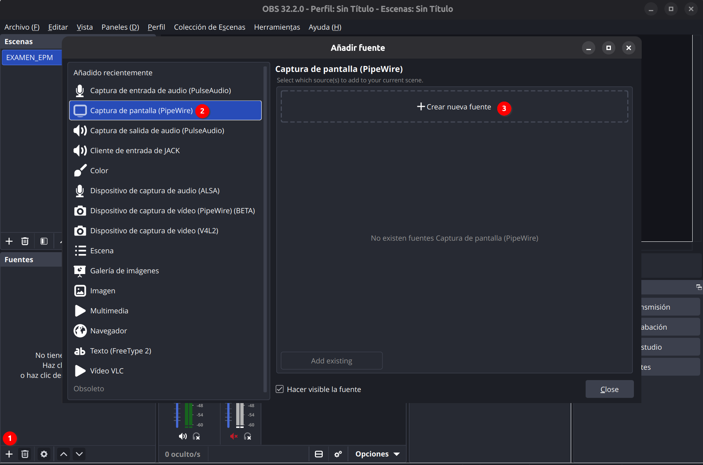
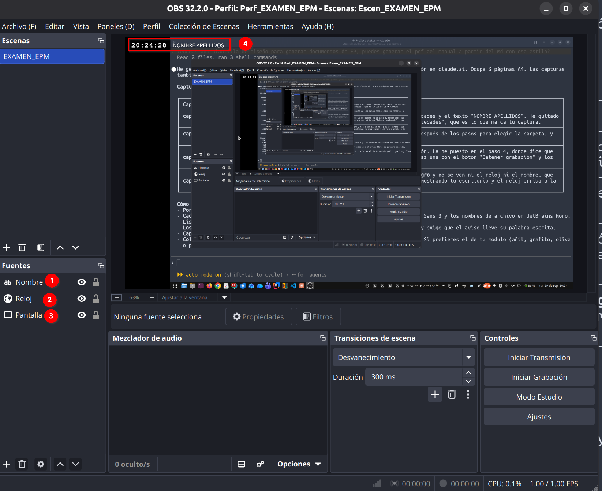
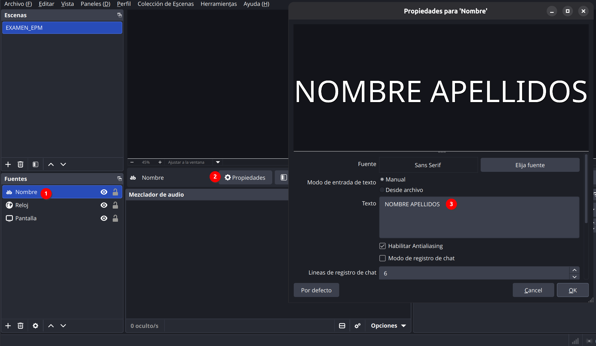
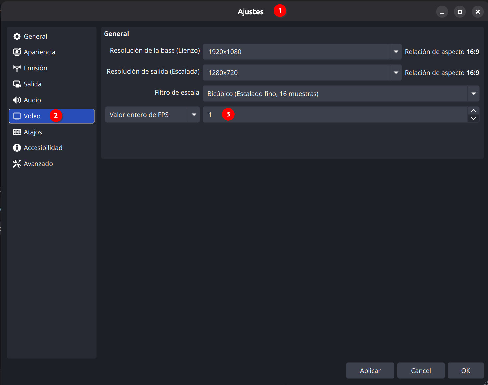
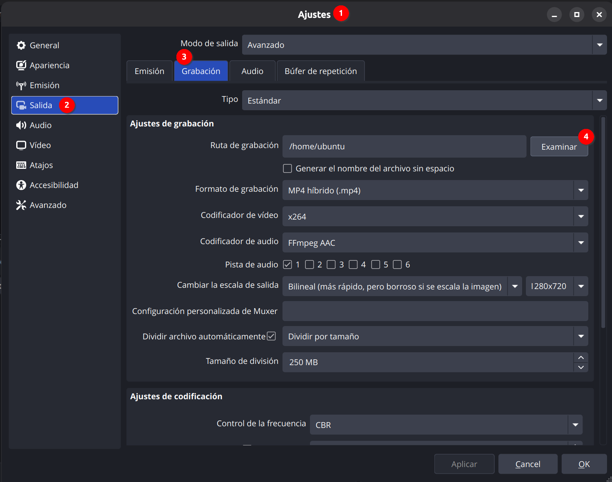

# UD01 · Taller 1 — Configurar OBS para grabar los exámenes

!!! important "Entrega · hecho / no hecho"
    Se entrega en Aules y se califica como **hecho / no hecho**: se registra en el libro de
    calificaciones con **peso 0** —no puntúa, pero consta— y **es requisito**. En las pruebas
    prácticas del módulo grabarás tu pantalla con esta configuración, así que tiene que funcionar
    en tu portátil **antes** de la primera.

**Objetivo**: dejar OBS Studio configurado con la plantilla del módulo y comprobar, con una
grabación corta, que en el vídeo se ven siempre la hora (con segundos) y tu nombre.

## Por qué se graban los exámenes

En los exámenes prácticos grabarás tu pantalla mientras trabajas. La grabación muestra en todo
momento **la hora del sistema (con segundos) y tu nombre**, y sirve para comprobar quién ha hecho el
examen, cuándo y cómo.

Para grabar se usa [OBS Studio](https://obsproject.com/es), un programa **libre, gratuito y de
código abierto** que funciona en **Linux, Windows y macOS**. El profesor te da una plantilla ya
configurada: solo tienes que importarla, escribir tu nombre y elegir dónde se guarda el vídeo.

## Antes de empezar

Necesitas:

- **OBS Studio** instalado. Si no lo tienes, descárgalo gratis desde
  [obsproject.com](https://obsproject.com/es/download).
- La plantilla [`EXAMEN_OBS.zip`](assets/EXAMEN_OBS.zip){: download="EXAMEN_OBS.zip" }.

**Descomprime el zip** antes de continuar (clic derecho → *Extraer todo* en Windows, doble clic en
macOS). Tendrás una carpeta con:

- `Escen_EXAMEN_EPM.json` → la colección de escenas (reloj y nombre)
- `Perf_EXAMEN_EPM` → la carpeta del perfil (ajustes de grabación)

!!! warning "Atención"
    No intentes importar directamente desde dentro del zip sin descomprimirlo: OBS no lo encontrará.

### Fase 1 — Instala OBS e importa la plantilla

1. Instala OBS Studio si no lo tienes.
2. Abre OBS. En **macOS**, los menús **Perfil** y **Colección de escenas** están en la barra de
   menús de arriba del todo de la pantalla, no dentro de la ventana de OBS.
3. Importa el perfil: menú **Perfil → Importar** y selecciona la carpeta **`Perf_EXAMEN_EPM`**.
   Después, abre otra vez el menú **Perfil** y haz clic en **Perf_EXAMEN_EPM** para activarlo
   (importar no lo activa).
4. Importa la colección de escenas: menú **Colección de escenas → Importar**, pulsa el botón **…**
   para buscar el archivo **`Escen_EXAMEN_EPM.json`** y acepta. Después, abre otra vez el menú
   **Colección de escenas** y haz clic en **Escen_EXAMEN_EPM** para activarla.

!!! warning "Atención"
    Tienes que elegir **exactamente** la carpeta `Perf_EXAMEN_EPM`: la que tiene dentro el archivo
    `basic.ini`. Si eliges la carpeta que la contiene (la que se creó al descomprimir el zip, por
    ejemplo `EXAMEN_OBS`), OBS no da ningún error pero no importa nada, y en el menú **Perfil** solo
    seguirá apareciendo el perfil que ya tenías (normalmente **Sin título**). Si te pasa, repite la
    importación entrando en la carpeta del zip y seleccionando `Perf_EXAMEN_EPM`.

!!! tip "Si el perfil sigue sin aparecer"
    Cópialo a mano en la carpeta de perfiles de OBS:

    1. Cierra OBS.
    2. Abre la carpeta de perfiles de OBS:
        - **macOS**: en Finder, menú **Ir → Ir a la carpeta…**, pega
          `~/Library/Application Support/obs-studio/basic/profiles/` y pulsa Intro.
        - **Windows**: pulsa **Windows + R**, escribe `%APPDATA%\obs-studio\basic\profiles` y pulsa
          **Aceptar**.
        - **Linux**: abre `~/.config/obs-studio/basic/profiles/` (si instalaste OBS con Flatpak:
          `~/.var/app/com.obsproject.Studio/config/obs-studio/basic/profiles/`).
    3. Si ya hay una carpeta `Perf_EXAMEN_EPM` (o con el nombre de la carpeta del zip, como
       `EXAMEN_OBS`) que dejaron los intentos fallidos, bórrala.
    4. Copia ahí la carpeta **`Perf_EXAMEN_EPM`** del zip.
    5. Abre OBS y actívalo desde el menú **Perfil → Perf_EXAMEN_EPM**.

La plantilla trae una fuente llamada **"Pantalla"** preparada para Linux. Si usas **Windows o
macOS** (o Linux sin Wayland), al activar la colección aparecerá un aviso de que falta esa fuente.
Es normal: se soluciona así.

1. Cierra el aviso.
2. En el panel **Fuentes**, selecciona **"Pantalla"** y bórrala con el botón de la papelera.
3. Pulsa el botón **+** y elige la captura de pantalla completa de tu sistema:

- Windows → **Captura de pantalla**
- macOS → **Captura de pantalla de macOS**
- Linux con Wayland → **Captura de pantalla (PipeWire)** (ya viene en la plantilla; OBS te pedirá
  elegir qué pantalla compartir)
- Linux con X11 → **Captura de pantalla (XSHM)**

4. Llámala **"Pantalla"** y acepta.
5. Asegúrate de que queda **la última** de la lista de fuentes, debajo de "Nombre" y "Reloj". Si
   queda arriba, tapará el nombre y el reloj: arrástrala hacia abajo o usa la flecha ↓.

!!! warning "La captura debe ocupar toda la grabación"
    Uses el sistema que uses (también en Linux con Wayland, si te quedas con la fuente "Pantalla"
    que trae la plantilla), tu escritorio tiene que llenar **toda** la vista previa de OBS, sin
    bordes negros alrededor. Si se ve reducido dentro de un recuadro, haz clic derecho sobre la
    fuente **"Pantalla"** → **Transformar** → **Ajustar a la pantalla** (o selecciónala y pulsa
    **Ctrl+F**; en macOS, **Cmd+F**). Si tu pantalla no es panorámica (16:9), pueden quedar franjas
    finas a los lados o arriba y abajo: eso es normal.

!!! note "Solo en macOS: permiso de grabación de pantalla"
    Al añadir la captura, macOS te pedirá permiso de **grabación de pantalla** para OBS. Sin ese
    permiso la captura sale en negro, así que dáselo:

    1. Abre **Ajustes del Sistema → Privacidad y seguridad → Grabación de pantalla y audio del
       sistema** (en versiones antiguas de macOS se llama solo **Grabación de pantalla**).
    2. Activa el interruptor de **OBS**.
    3. macOS te pedirá **salir y volver a abrir** OBS: acepta. Al volver a abrirlo, comprueba que
       la fuente "Pantalla" ya muestra tu escritorio; si sigue en negro, haz doble clic sobre ella
       y elige tu pantalla en **Pantalla**.

    Si OBS te pide también permiso de micrófono, cámara o accesibilidad, no hace falta que lo des:
    para el examen solo se graba la pantalla. Haz esta configuración **antes del día del examen**,
    porque hay que reiniciar OBS después de dar el permiso.

### Fase 2 — Comprueba que el reloj aparece

La plantilla ya incluye una fuente de tipo **Navegador** llamada **"Reloj"**, con el reloj ya
integrado (no necesitas ningún archivo aparte ni conexión a internet). No tienes que crearla ni
tocarla, solo comprobar que aparece en la esquina superior izquierda de la vista previa:

Si no la ves, comprueba que el ojo junto a la fuente "Reloj" en el panel **Fuentes** está activado.

!!! warning "Linux: usa una versión reciente de OBS"
    Las versiones antiguas de OBS que traen algunos repositorios de distribuciones (por ejemplo,
    la 27) no incluyen la fuente **Navegador**, y el reloj sale vacío. Instala OBS 30 o posterior;
    lo más sencillo es la versión **Flatpak** que enlaza [obsproject.com](https://obsproject.com/es/download).

### Fase 3 — Escribe tu nombre

1. En el panel **Fuentes**, busca la fuente de texto llamada **"Nombre"**.
2. Haz doble clic sobre ella (o selecciónala y pulsa **Propiedades**).
3. Borra el texto de ejemplo **"NOMBRE APELLIDOS"**.
4. Escribe tu nombre y apellidos reales.
5. Cierra la ventana de propiedades. No cambies su tamaño ni su posición: tiene que quedar junto al
   reloj, sin taparlo.

!!! warning "Atención"
    La fuente debe ser de tipo **Texto (FreeType 2)**. Si por error creas una nueva y tu sistema te
    ofrece **Texto (GDI+)**, no la uses: esa variante solo existe en Windows y en Mac/Linux no
    aparecerá.

### Fase 4 — Elige dónde se guarda el vídeo

La resolución (1280×720), los fotogramas por segundo (1 FPS) y el formato de grabación (MP4) ya
vienen preconfigurados en el perfil que has importado. No cambies nada en **Ajustes → Vídeo**.

Lo único que debes revisar es la carpeta donde se guardará la grabación:

1. Abre **Ajustes → Salida** y ve a la pestaña **Grabación**.
2. En **Ruta de grabación**, pulsa **Examinar** y elige tu carpeta **Vídeos**.
3. Pulsa **OK**. No toques ningún otro ajuste de esa pantalla.

### Fase 5 — Graba

1. Comprueba en la vista previa de OBS que se ven **tu nombre** y **el reloj con los segundos** en
   la esquina de la pantalla, y que tu escritorio ocupa toda la vista previa, sin bordes negros
   alrededor.
2. Pulsa **Iniciar grabación**.
3. Trabaja con normalidad durante **al menos 10 segundos**.
4. Al terminar, pulsa **Detener grabación**.
5. El vídeo queda en la carpeta que elegiste en la fase 4, con la fecha y la hora en el nombre del
   archivo. Ábrelo y comprueba que se reproduce bien.

!!! info "Grabaciones largas"
    OBS divide automáticamente la grabación en varios archivos de unos 45 MB (unos 40 minutos de
    grabación cada uno), porque Aules no admite ficheros de más de 50 MB. En un examen de más de 40
    minutos tendrás varios vídeos con la fecha y hora en el nombre: **hay que entregarlos todos**, no
    solo el último.

!!! info "Resumen"
    Importas y **activas** el perfil `Perf_EXAMEN_EPM` y la colección `Escen_EXAMEN_EPM`, cambias la
    fuente "Pantalla" por la de tu sistema si hace falta (siempre la última de la lista y ajustada a
    toda la pantalla), escribes tu nombre en la fuente "Nombre" y eliges la carpeta de grabación.
    El resto ya viene configurado.

<!-- AUTO:entrega inicio -->
## Entrega

Sube a la tarea **T01 · Configurar OBS para grabar los exámenes** de Aules un único fichero **`.mp4`** con:

- la grabación de al menos 10 segundos que genera OBS, sin editar, con el reloj, tu nombre y tu escritorio a pantalla completa.

Aules **solo acepta un vídeo `.mp4`** en esta tarea. El plazo acaba a las **23:59** del día que marca la tarea; después la tarea se cierra y ya no admite entregas.
<!-- AUTO:entrega fin -->

**Qué tiene que verse en el vídeo**

| Requisito | Cómo se comprueba |
|---|---|
| Perfil de la plantilla activo | El vídeo es de 1280×720 a 1 FPS; el título de OBS dice `Perfil: Perf_EXAMEN_EPM` |
| Reloj con segundos | Arriba a la izquierda, avanzando durante toda la grabación |
| Tu nombre real | Junto al reloj, sin taparlo y no el texto de ejemplo "NOMBRE APELLIDOS" |
| Pantalla completa | Tu escritorio ocupa toda la grabación, sin bordes negros |
| Duración | Al menos 10 segundos |

!!! note "Soluciones"
    No aplica: este taller se evalúa por la configuración conseguida, no hay una única respuesta
    correcta que corregir en clase.

---
[Volver a la UD01](UD01_ES.md) · [Qué se entrega](UD01_Entregas.md)
